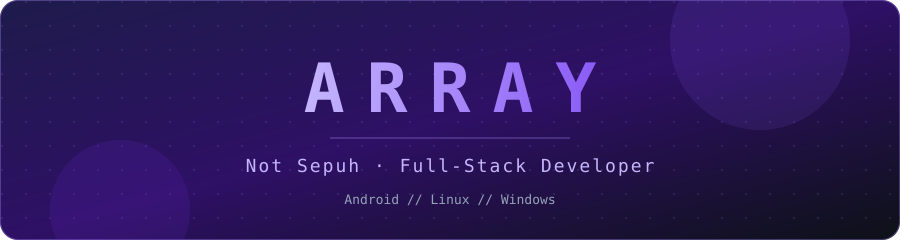
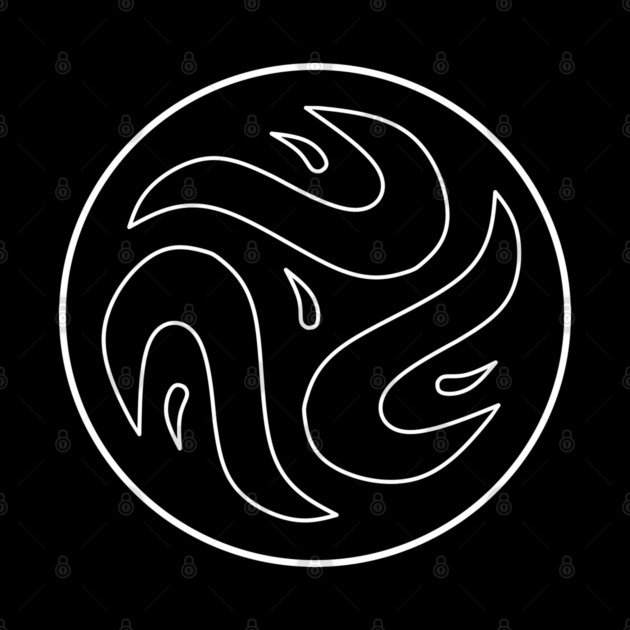
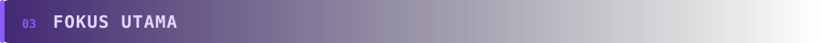
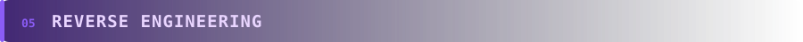
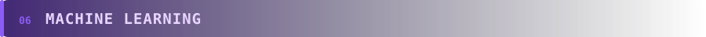
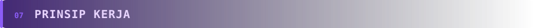
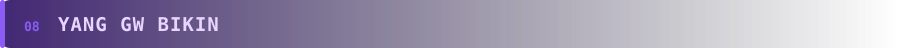
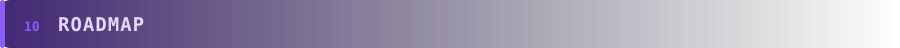
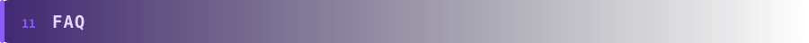
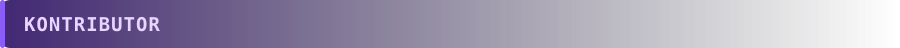

<div align="center">
  
  <br/><br/>
  
  <br/><br/>
  <a href="https://git.io/typing-svg"></a>
  <br/>
  
  
  
  <br/><br/>
  <a href="#about"></a>
  <a href="#fokus"></a>
  <a href="#stack"></a>
  <a href="#re"></a>
  <a href="#ml"></a>
  <a href="#stats"></a>
  <a href="#kontak"></a>
</div>

<br/>

<a id="about"></a>


<table>
<tr>
<td width="32%" align="center" valign="middle">
  
</td>
<td width="68%" valign="middle">

Gw dev yang suka main di level bawah: low-level programming, toolchain di HP, sampai full-stack. Pola pikir gw first principles, jadi gw lebih seneng bikin tool, IDE, bot otomasi, dan aplikasi ngebut dari nol daripada cuma pakai yang udah jadi, biasanya gw memprogram sebuah aplikasi Android untuk kegunaan tertentu.

</td>
</tr>
</table>

<div align="center"></div>

<a id="profil"></a>


<div align="center">

| | |
| :--- | :--- |
| **Handle** | Array |
| **Title** | Full-Stack Developer |
| **Bidang** | Software Engineering, Reverse Engineering, Machine Learning, System Programming |
| **Environment** | Android, Linux, Windows |
| **Mindset** | First principles, bikin dari nol, paham layer di bawahnya |
| **Status** | Aktif tiap hari |
| **Lokasi** | Indonesia, West Java |
| **Bahasa** | Bahasa Indonesia, English |

</div>

<div align="center"></div>

<a id="fokus"></a>


<table>
<tr>
<td width="50%" valign="top">

#### Software Engineering

Bikin sistem yang rapi, modular, dan gampang dirawat. Fokus ke arsitektur, performa, testing, dan dokumentasi yang jelas dari awal sampai rilis.


</td>
<td width="50%" valign="top">

#### Reverse Engineering

Bongkar binary, aplikasi mobile, dan protokol buat ngerti cara kerja dalamnya. Analisis statis dan dinamis, dekompilasi, patching, sampai instrumentasi runtime.


</td>
</tr>
<tr>
<td width="50%" valign="top">

#### Machine Learning

Bikin pipeline data, latih model, terus pasang inferensinya ke aplikasi beneran. Dari klasifikasi biasa sampai deep learning dan computer vision.


</td>
<td width="50%" valign="top">

#### Systems and Toolchain

Bikin compiler pipeline, IDE, build system, dan toolchain di perangkat mobile. Kerjanya deket banget sama memori, proses, dan sistem operasi.


</td>
</tr>
</table>

<div align="center"></div>

<a id="stack"></a>


| Kategori | Teknologi |
| :--- | :--- |
| **Languages** |        |
| **Web & Scripting** |       |
| **Frameworks & Libraries** |                |
| **Databases** |          |
| **Hosting & Cloud** |       |
| **Shell & Terminals** |    |
| **Machine Learning & Data** |           |
| **DevOps & Tooling** |         |
| **Mobile & Android Internals** |      |

<br/>

<div align="center">
  
  <br/><br/>
  
  <br/><br/>
  
  <br/><br/>
  
  <br/><br/>
  
</div>

<div align="center"></div>

<a id="re"></a>


Cara gw ngerjain reverse engineering itu rapi: kumpulin info, bikin hipotesis, tes secara dinamis, terus catat hasilnya. Semua dikerjain buat riset, belajar, interoperabilitas, dan ngamanin sistem sendiri atau yang udah ada izinnya.

| Bidang | Yang Dikerjain | Tools |
| :--- | :--- | :--- |
| **Native Binary** | Bongkar binary, decompile, baca alur kontrol, cari struktur datanya |     |
| **Android / APK** | Decompile APK, baca Smali & DEX, cek manifest dan resource |    |
| **Dynamic Instrumentation** | Hooking, tracing, intip memori, liat perilaku pas jalan |    |
| **Network & Protocol** | Tangkap & bedah traffic, reverse protokol custom, cek TLS di lingkungan uji |    |
| **Scripting & Automation** | Otomasi analisis, parser format file, tool buatan sendiri |    |

<table>
<tr>
<td width="60%" valign="top">

**Metodologi**

```text
01. Recon        -> kenali format, arsitektur, packer, dan dependensi
02. Static       -> baca struktur, string, import, dan alur kontrol
03. Dynamic      -> jalanin di sandbox, hook fungsi kunci, pantau memori
04. Hypothesis   -> bikin model cara kerjanya, buktiin lewat eksperimen
05. Document     -> catat temuan, tulis ulang jadi tool atau library
```

</td>
<td width="40%" align="center" valign="middle">
  
</td>
</tr>
</table>

<div align="center"></div>

<a id="ml"></a>


Di ML gw fokus yang praktis: data bersih, eksperimen bisa diulang, dan model yang beneran jalan di produk nyata, termasuk di perangkat yang sumber dayanya terbatas.

| Tahap | Yang Dikerjain | Teknologi |
| :--- | :--- | :--- |
| **Data** | Ngumpulin data, bersihin, feature engineering, visualisasi |    |
| **Modeling** | Klasifikasi, regresi, clustering, deep learning, computer vision |    |
| **Vision & NLP** | Deteksi objek, OCR, olah teks, model bahasa |   |
| **Deployment** | Ekspor model, optimasi, inferensi di server dan HP |    |
| **Research Flow** | Notebook, eksperimen, catat hasil |   |

<div align="center"></div>

<a id="prinsip"></a>


| Prinsip | Artinya |
| :--- | :--- |
| **First Principles** | Pahami layer di bawahnya dulu sebelum pakai abstraksi di atasnya. |
| **Build From Scratch** | Bikin ulang komponen penting itu jalan paling cepet buat bener-bener nguasain. |
| **Performance Aware** | Ukur dulu baru optimasi, ngerti alokasi memori, hindari kerumitan yang gak perlu. |
| **Simple Over Clever** | Kode yang gampang dibaca lebih berharga daripada trik yang susah dirawat. |
| **Automate Everything** | Kerjaan yang diulang tiga kali layak dijadiin script, bot, atau pipeline. |
| **Document As You Go** | Dokumentasi itu bagian dari produk, bukan tambahan di akhir. |
| **Security By Default** | Validasi input, kecilin permukaan serangan, dan jangan simpan rahasia di repository. |

<div align="center"></div>

<a id="bikin"></a>


| Kategori | Deskripsi |
| :--- | :--- |
| **Mobile IDE and Toolchain** | Lingkungan dev yang jalan langsung di Android, lengkap sama compiler, build system, dan debugger. |
| **Automation Bots** | Bot buat platform chat, pantau sistem, dan alur kerja otomatis berbasis event. |
| **High-Performance Apps** | Aplikasi desktop dan mobile yang butuh performa tinggi, termasuk game LibGDX. |
| **Backend and API** | Layanan REST dan realtime pakai Node.js, FastAPI, Laravel, plus database relasional maupun NoSQL. |
| **Reverse Engineering Tools** | Parser format, analyzer, dan utilitas bantu buat analisis binary dan aplikasi Android. |
| **ML-Powered Features** | Masukin model prediksi, computer vision, dan olah teks ke dalam produk. |

<div align="center"></div>

<a id="stats"></a>


<div align="center">


<br/><br/>

<br/><br/>

<br/><br/>

<br/><br/>
<a href="https://github.com/arraynothere?tab=followers"></a>
<a href="https://github.com/arraynothere?tab=repositories"></a>
<a href="https://github.com/arraynothere?tab=repositories"></a>
<a href="https://github.com/arraynothere"></a>
<a href="https://github.com/arraynothere/arraynothere/commits"></a>

</div>

<div align="center"></div>

<a id="roadmap"></a>


| Bidang | Target | Status |
| :--- | :--- | :--- |
| **Systems** | Perdalam toolchain native dan build system buat lingkungan mobile |  |
| **Reverse Engineering** | Bikin toolkit analisis APK dan binary yang otomatis |  |
| **Machine Learning** | Gabungin model inferensi ringan ke aplikasi Android |  |
| **Backend** | Arsitektur API yang scalable dengan observability yang bagus |  |
| **Open Source** | Rapiin, dokumentasiin, dan rilis proyek ke publik |  |

<div align="center"></div>

<a id="faq"></a>


<details>
<summary><b>Bahasa pemrograman apa yang paling sering dipakai?</b></summary>
<br/>

Tergantung kebutuhan. C dan C++ buat sistem dan performa, Kotlin dan Java buat Android, Python buat ML dan otomasi, TypeScript buat web.

</details>

<details>
<summary><b>Terbuka buat kolaborasi gak?</b></summary>
<br/>

Terbuka. Tinggal buka issue atau hubungi lewat sosial di bawah.

</details>

<div align="center"></div>

<a id="kontak"></a>


<div align="center">

[](https://tiktok.com/@arraysevenera)
[](https://youtube.com/@arraynothere)
[](https://github.com/arraynothere)

</div>

<div align="center"></div>

<a id="kontributor"></a>


<div align="center">

<a href="https://github.com/arraynothere/NAMA_REPO/graphs/contributors"></a>

</div>

<div align="center"></div>

<div align="center">
  
  <br/><br/>
  
  <br/><br/>
  <a href="https://visitcount.itsvg.in"></a>
  <br/>
  <sub>Made by Array with Seven Rules 🕊️</sub>
</div>
